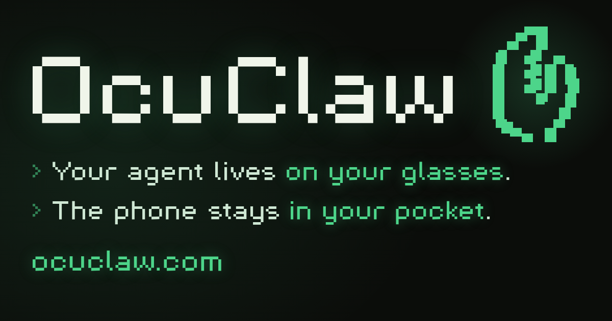

<p align="center">
  
</p>

# OcuClaw

Your OpenClaw agent on your Even Realities G2 smart glasses.

[Website](https://ocuclaw.com) · [Setup guide](https://ocuclaw.com/setup) · [Discord](https://discord.ocuclaw.com)

Using Hermes Agent? Use [OcuClaw for Hermes](https://github.com/ocuclaw/ocuclaw).

## Requirements

- Even Realities G2 smart glasses and the OcuClaw app from Even Hub.
- OpenClaw 2026.9.5 or newer.
- Tailscale on your phone and on the OpenClaw host. On Cloudways, setup
  installs the host part for you.

## Install

```bash
openclaw plugins install clawhub:ocuclaw
```

On OpenClaw 2026.9 and later the install asks you to confirm (`y/N`).
OcuClaw lets your agent draw on the glasses display, read glasses and device
state, read your phone's location when you turn it on in the app, and run
setup. Answer `y` to install. ClawHub may ask twice.

OcuClaw reads and writes the conversation your glasses are paired to. That is
how replies reach your glasses and your voice reaches your agent. OpenClaw
keeps this behind a setting, and OcuClaw turns it on for itself the first time
it loads (`plugins.entries.ocuclaw.hooks.allowConversationAccess`). It covers
OcuClaw only. It does not reach other plugins or your credentials. To keep it
off, set it to `false`. OcuClaw never changes a `false`.

Then ask your agent to **set up OcuClaw**. It pairs your phone and checks each
step, on a Cloudways managed host too. Prefer the terminal there? Run
`openclaw ocuclaw cloudways setup`.

Installing again after an uninstall? OpenClaw 2026.9 may keep OcuClaw
switched off. If a command says `plugins.entries.ocuclaw.enabled=false`, run
`openclaw plugins enable ocuclaw`, then try again.

## Update

```bash
openclaw plugins update ocuclaw
```

Installed from npm, or without the `clawhub:` prefix? Use
`openclaw plugins update ocuclaw@latest`. Not sure?
`openclaw plugins inspect ocuclaw --json` shows `install.source`.

## Uninstall

On Cloudways, run `openclaw ocuclaw cloudways rollback --yes` first. Then:

```bash
openclaw plugins uninstall ocuclaw
openclaw config unset plugins.entries.ocuclaw
```

The second line clears the switched-off entry OpenClaw 2026.9 leaves behind,
so a later install starts switched on. On older OpenClaw it says
`Config path not found`. That is fine: there was nothing to clear.

On other hosts, also turn off the Tailscale routes setup made for OcuClaw
(use `sudo` on Linux and macOS). Check `tailscale serve status` and skip any
route you did not make for OcuClaw:

```bash
tailscale serve --tls-terminated-tcp=8444 off
tailscale serve --https=8443 off   # only if you set up Even AI
```

## Help

Stuck? Run `openclaw ocuclaw doctor`. It checks your setup, marks each item
✓ (fine), ✗ (must fix) or ! (worth a look), and prints a `Fix:` line for each
problem. It exits with code 1 while anything blocks OcuClaw; add `--json` for
the full report. You can also use **Report a bug** in the OcuClaw app, or ask
on [Discord](https://discord.ocuclaw.com).

Settings, voice keys, Even AI and diagnostics are in the
[configuration reference](https://github.com/ocuclaw/ocuclaw-openclaw-plugin/blob/main/package/CONFIGURATION.md).

## About this package

On your host, OcuClaw runs a private relay for the phone, protected by a
credential it generates. Optional voice and Even AI keys are stored on this
host. On Cloudways, setup uses the server's own Tailscale and keeps the relay on
your private Tailscale network. OcuClaw keeps that Tailscale running: it starts
it again after the gateway or the server restarts. If Cloudways' own Tailscale
is already running and signed in, setup uses it as it is.

When an agent asks for an API key with OpenClaw's `secrets` tool, OcuClaw
shows a masked box on your phone. The key goes from your phone over the relay
straight to OpenClaw's own secret store. OcuClaw does not keep it, log it or
show it in chat, and it never takes a key typed or spoken in chat.

OcuClaw is a community package, not an official or bundled OpenClaw plugin.
ClawHub releases carry source attribution to
[ocuclaw/ocuclaw-openclaw-plugin](https://github.com/ocuclaw/ocuclaw-openclaw-plugin).
Check the clean scan status on [ClawHub](https://clawhub.ai/ocuclaw/plugins/ocuclaw).
